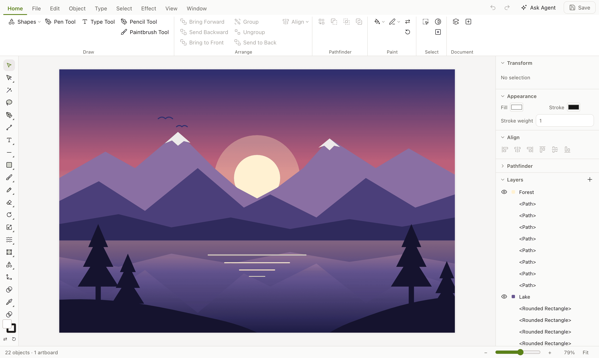
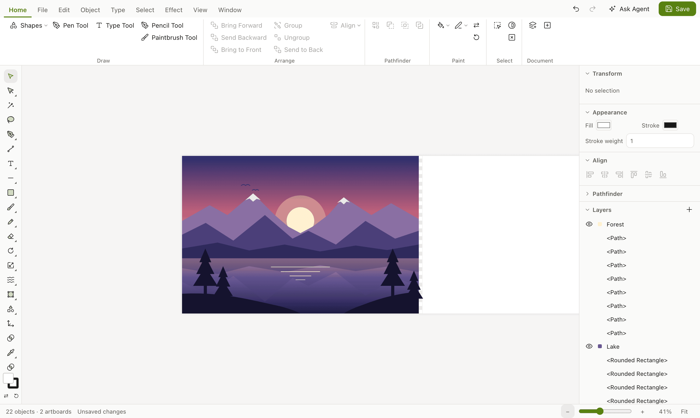
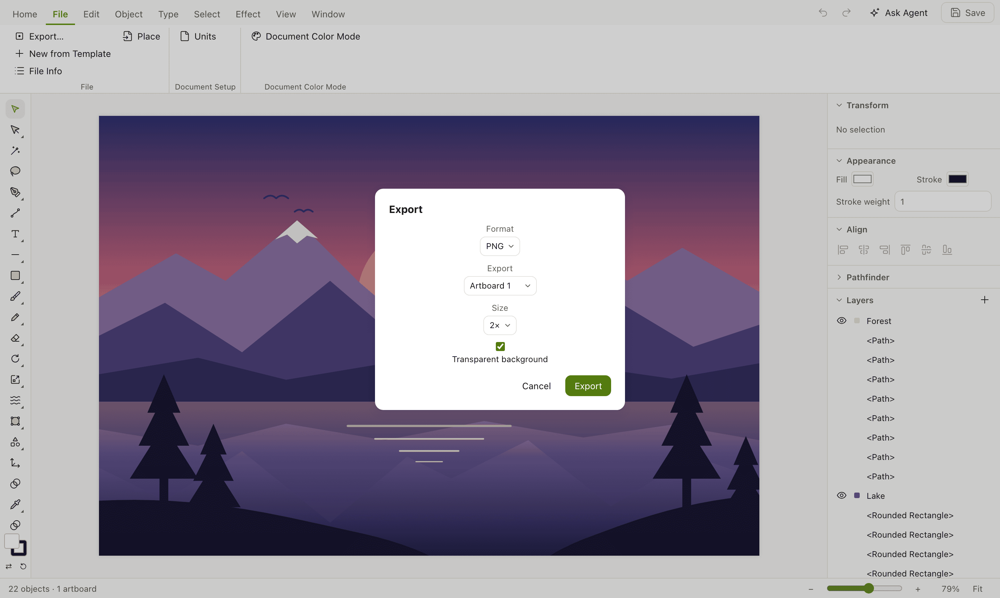
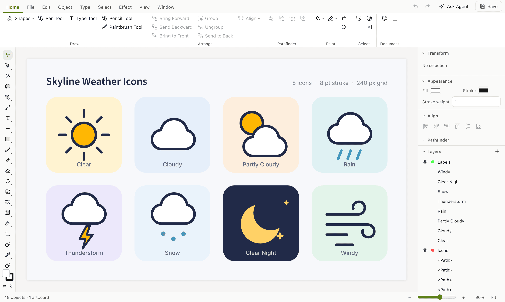
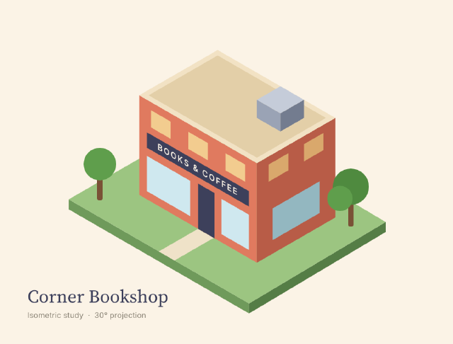
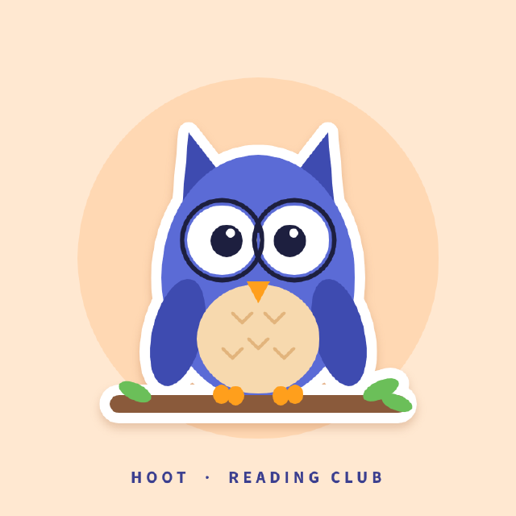
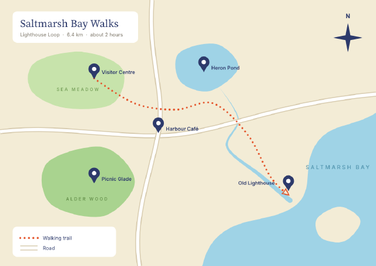
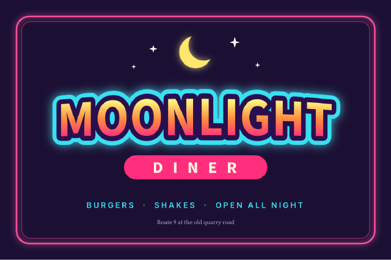

<div align="center">

# Kition Vector

**Kition Vector: a vector graphics editor, for people and AI agents**

Illustrations on artboards · SVG, PDF and PNG export · `.svg`, `.ai` and `.eps` for viewing · Tools for agents

[](LICENSE)
[](https://www.npmjs.com/package/@kition/embed)
[](https://github.com/kitharness/kitharness)
[](bindings/wasm)

[Use it in Kition](https://kition.ai) · [Embed it](#embed-it-in-your-app) · [Give it to your agent](#give-it-to-your-agent) · [Showcase](https://github.com/KitionAI/kition-showcase/tree/main/vector) · [Developer docs](https://developer.kition.ai) · [KHP](https://github.com/kitharness/kitharness)

</div>

An illustration or an icon set usually lives in one desktop program, in a file only that program
edits well. You send a PNG round for comments and carry every change back by hand. An AI assistant
can suggest a colour or a layout, but it cannot open the drawing and change it.

Vector puts a vector illustration editor in a browser tab, on a `.kvector` drawing: the tools, the
artboards and the layers in one view. The same engine runs headless for an AI agent: it reads every
layer and object, works with the editor's own commands, and runs the same check. An agent can work
in a draft that you review before anything changes in your file.



## What it does

### Why Vector

- **Your drawing is one file.** A `.kvector` holds the artboards, the layers and every object.
  Open it, save it, save a copy or revert to the saved version.
- **Look at SVG, AI and EPS files.** Open an `.svg`, `.ai` or `.eps` file for viewing in the same
  editor.
- **Export what you share.** File › Export writes an SVG, a PDF or a PNG: the whole drawing or one
  artboard, a PNG at the size you choose.
- **Your agent works on the same drawing.** An AI agent reads every layer and object, adds
  artboards, and fixes what the check reports. It can work in a draft that you review before it
  changes the file.
- **Find a drawing by its words.** The words on each artboard, in reading order, go to the host
  for search.
- **Room to draw, or every panel.** Classic shows the ribbon and the panels, Single line keeps the
  commands on one row, and Focus shows the drawing alone.

### See it

<table>
<tr>
<td width="50%"><br /><b>Selection</b>: click the sun; its handles appear, and Transform and Appearance show its place, size and fill.</td>
<td width="50%"><br /><b>Artboards</b>: New Artboard adds one beside the last; an agent adds them with the same command.</td>
</tr>
<tr>
<td width="50%"><br /><b>Export</b>: File › Export writes SVG, PDF or PNG; here one artboard as a PNG at 2×.</td>
<td width="50%"><br /><b>SVG for viewing</b>: an <code>.svg</code> opened in the editor, here the weather icons exported from Vector.</td>
</tr>
</table>

### Made with Vector

<table>
<tr>
<td width="25%"><a href="https://github.com/KitionAI/kition-showcase/tree/main/vector/isometric-corner-bookshop"></a></td>
<td width="25%"><a href="https://github.com/KitionAI/kition-showcase/tree/main/vector/reading-owl-mascot"></a></td>
<td width="25%"><a href="https://github.com/KitionAI/kition-showcase/tree/main/vector/saltmarsh-bay-trail-map"></a></td>
<td width="25%"><a href="https://github.com/KitionAI/kition-showcase/tree/main/vector/retro-diner-lettering"></a></td>
</tr>
</table>

Every sample is built with Vector's own commands. [See all of them](https://github.com/KitionAI/kition-showcase/tree/main/vector).

### Formats

| Opens | Creates | Exports |
| --- | --- | --- |
| `.kvector`; `.svg`, `.ai` and `.eps` for viewing | `.kvector` | `.svg`, `.pdf`, `.png` |

## Quick start

### Use it in Kition

Open or create a `.kvector` file in Kition and it opens in this editor. Kition's agent works on the
same drawing, with the same commands. [Download Kition](https://github.com/KitionAI/kition/releases/latest).

### Embed it in your app

Vector's editor is a static package you host yourself, mounted into your page with
[`@kition/embed`](https://www.npmjs.com/package/@kition/embed). Download
`kition-vector-<version>.tgz` from the [latest release](https://github.com/KitionAI/kition-vector/releases/latest)
and serve its `vector-ui/` folder on its own origin, with the headers in the
[embed reference](https://github.com/KitionAI/kition-sdk/blob/main/docs/platform/reference/embed.md).
Then:

```ts
import { KitionEmbed } from '@kition/embed'

const editor = await KitionEmbed.mount(document.getElementById('vector')!, {
  kit: { id: 'kit.vector', url: 'https://kits.example.com/vector-ui/' }, // the package you host
  file: { id: 'poster-2026', name: 'Poster.kvector' },
  storage: {
    read: async (id) => api.read(id),                                     // { bytes, version }
    write: async (id, bytes, { expectedVersion }) => api.write(id, bytes, expectedVersion), // refuse a stale version
    create: async (name, bytes) => api.create(name, bytes),              // exports (SVG, PDF, PNG) become new files
  },
})
```

Every save carries the version it read, so an edit made elsewhere is never written over. The
[embed guide](https://github.com/KitionAI/kition-sdk/blob/main/docs/sdk/embed.md) adds people and
permissions, co-editing, and an agent working in the open editor.

### Give it to your agent

The engine also runs headless, and `kition`, the Kition SDK's command line, serves it as MCP tools
(`vector_inspect`, `vector_run`, `vector_check`, ...) on a folder of drawings, for any MCP client.
Nothing is compiled: you need neither Rust nor the Kition app. Install `kition`, then connect your
agent in the folder:

```sh
curl -fsSL https://github.com/KitionAI/kition-sdk/releases/latest/download/install.sh | sh
# Claude Code, in the folder:
claude mcp add kition -- ~/.kition/bin/kition mcp --workspace "$PWD"
```

On Windows, install it with
`irm https://github.com/KitionAI/kition-sdk/releases/latest/download/install.ps1 | iex`. With
Node.js 20 or later you can skip the install:
`claude mcp add kition -- npx -y @kition/kits-mcp --workspace "$PWD"`.

`kition` holds no kit. The first time the agent opens a `.kvector` file, through the `kit_inspect`
tool the server offers until Vector is installed, `kition` downloads Vector's headless executable
into `~/.kition/kits` and the vector tools appear. `kition kit install vector` downloads it ahead of
time, and `kition kit upgrade` moves it to the newest version. Claude Desktop, Cursor, Codex and the
other commands are in the SDK's
[agent guide](https://github.com/KitionAI/kition-sdk/blob/main/docs/sdk/agent.md#connect-your-agent)
and [`kition` guide](https://github.com/KitionAI/kition-sdk/blob/main/docs/sdk/cli.md). To run a
build of your own (working on the kit itself), see
[docs/development.md](docs/development.md#run-the-headless-kit-for-an-agent).

A real session on a copy of the landscape above, trimmed:

```text
> vector_inspect {"path":"lake.kvector"}
Opened `lake.kvector`: 1200 × 800
{"details":{"artboards":[{"height":800.0,"name":"Artboard 1","width":1200.0,"x":0.0,"y":0.0}],"colorMode":"Rgb",
  "layers":[{…,"children":[{"anchors":3,…,"id":27,"kind":"Path",…,"stroke":"#2b2d6e",…},…],…,"name":"Forest",…},
  {…,"name":"Lake",…},{…,"name":"Near Range",…},{…,"name":"Far Range",…},{…,"name":"Sky",…}],…},"revision":"zxf0",…}

> vector_run {"path":"lake.kvector","basis":"zxf0","steps":[
    {"command":"artboard.new","params":{"name":"Square","width":800,"height":800}}]}
Ran 1 commands on `lake.kvector` (saved): 2020 × 800 Changes: objects 1 created, 1 changed.
{"changes":{"changed":[{"edits":[{"after":[1,2],"before":[1],"field":"~artboards"}],…,"id":"drawing","type":"Drawing"}],
  "created":[{…,"id":"artboard:2","type":"Artboard","values":{"id":2,"props":{"name":"Square",…},
    "rect":{"x0":1220,"x1":2020,"y0":0,"y1":800}}}],…},
  "completed":[{"command":"artboard.new","result":{"index":1}}],"diagnostics":{"new":[],"resolved":[]},
  "revision":"zxf1","saved":true}

> vector_check {"path":"lake.kvector"}
Checked `lake.kvector`: the kit found nothing wrong.
{"diagnostics":[]}
```

The agent read the landscape's five layers and their objects, then added a square artboard, Square,
800 by 800, beside the first one. The check found nothing wrong. The agent's guide is
[agent/guide.md](agent/guide.md).

## Maturity

Version 0.1.0 · KHP 1.0, conformance level `basic`.

| Works today | Partly there | Not yet |
| --- | --- | --- |
| Opening, saving, saving a copy and reverting `.kvector` drawings | The pen and shape tools, and editing anchors | Recording and playing back actions |
| Opening `.svg`, `.ai` and `.eps` files for viewing | Fill, stroke, swatches and gradients | Scripting over the editor's commands |
| Export to SVG, PDF and PNG | Layers, groups, stacking order and transforms | 3D beyond a first Revolve |
| An agent that reads the drawing, adds artboards, fixes what the check reports and works in a draft | Point, area and path type with character and paragraph formats | Generative AI features |
| Classic, Single line and Focus display modes | Artboards, Pathfinder and the other Object menu commands | Some preferences: stored, not acted on yet |

Known gaps: [docs/gaps.md](docs/gaps.md). What's next: [docs/roadmap.md](docs/roadmap.md).

## Build and contribute

Build and test instructions are in [docs/development.md](docs/development.md). Read
[CONTRIBUTING.md](.github/CONTRIBUTING.md) before opening a pull request, and ask questions in
[Discussions](https://github.com/KitionAI/kition/discussions) or on [Discord](https://discord.gg/bFSjRDjVY).

## License

Apache-2.0 ([LICENSE](LICENSE)). Third-party licenses and notices are listed in [NOTICE](NOTICE)
and [docs/attribution.md](docs/attribution.md).

Portions of this kit are derived from a project licensed under the MIT License, used here under
that license and credited in [NOTICE](NOTICE).
